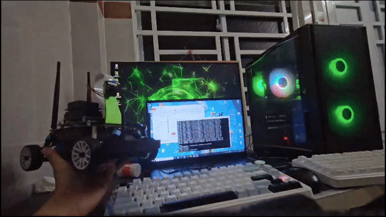
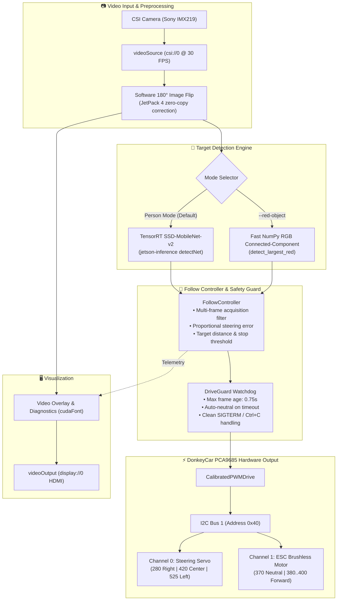

# 🏎️ Jetson Nano JetCar: Autonomous Human & Object Follow

<div align="center">

[](https://www.nvidia.com/en-us/autonomous-machines/embedded-systems/jetson-nano/)
[](https://developer.nvidia.com/embedded/jetpack)
[](https://www.donkeycar.com/)
[](https://github.com/dusty-nv/jetson-inference)
[](https://www.python.org/)
[](test_follow_control.py)

**A production-ready, safety-guarded autonomous target-following system for Jetson Nano-powered DonkeyCar / JetCar.**

<br/>



*Autonomous person tracking running on Jetson Nano with real-time CSI camera inference and PCA9685 PWM actuator control.*

</div>

---

## 📑 Table of Contents

- [Overview](#-overview)
- [Key Features](#-key-features)
- [System Architecture](#-system-architecture)
- [Hardware Wiring & Calibrated PWM](#-hardware-wiring--calibrated-pwm)
- [Project Structure](#-project-structure)
- [Installation & Quick Start](#-installation--quick-start)
- [Operating Modes](#-operating-modes)
  - [1. Safe HDMI Preview Mode](#1-safe-hdmi-preview-mode)
  - [2. Bench Steering Test](#2-bench-steering-test)
  - [3. Autonomous Person Follow Drive](#3-autonomous-person-follow-drive)
  - [4. Fast Red Object Tracking Mode](#4-fast-red-object-tracking-mode)
- [Safety & Fail-Safe Architecture](#-safety--fail-safe-architecture)
- [Actuator Diagnostics (`actuator_test.py`)](#-actuator-diagnostics-actuator_testpy)
- [Unit Testing](#-unit-testing)
- [CLI Reference](#-cli-reference)
- [Troubleshooting & FAQ](#-troubleshooting--faq)

---

## 🌟 Overview

This repository provides an end-to-end autonomous following robotic vehicle built upon NVIDIA Jetson Nano and the DonkeyCar platform. It enables the vehicle to smoothly track either a specific person using deep learning (`SSD-MobileNet-v2` accelerated by NVIDIA TensorRT) or the largest red object using an ultra-lightweight, zero-AI RGB color dominance algorithm.

Safety and hardware protection are designed as core principles: **preview mode never engages the motor controller**, a strict hardware watchdog (`DriveGuard`) kills throttle if frame processing lags, reverse gear is disabled, and throttle values are restricted to a verified, calibrated forward interval.

---

## 🚀 Key Features

- **Dual-Engine Tracking**:
  - **Person Mode**: Real-time object detection via TensorRT SSD-MobileNet-v2 (MS-COCO).
  - **Red Object Mode**: Zero-AI connected-component algorithm running purely on NumPy for minimal power consumption and maximum FPS.
- **Robust Fail-Safe System**:
  - `DriveGuard` watchdog resets actuators if inference or frame capture stalls (>0.75s).
  - Reverse lock: Throttle is clamped strictly to the safe forward range `[370, 400]`.
  - ESC deadband skipping: Positive commands smoothly map between `380` and `400` PWM pulses.
- **Hardware-Free Simulation & Dry-Run**:
  - 20 comprehensive unit tests that run on any x86/ARM desktop without camera or PCA9685 hardware connected.
  - `actuator_test.py` defaults to dry-run mode to verify math before applying signals.
- **Self-Contained & Offline**:
  - Portable pre-compiled UFF model and labels are bundled directly within the repository.
  - Zero external downloading required during on-field deployment.

---

## 🏗️ System Architecture



---

## 🔌 Hardware Wiring & Calibrated PWM

The JetCar connects to the PCA9685 16-channel 12-bit PWM servo driver via the Jetson Nano I2C Bus 1:

| Component | PCA9685 Channel | PWM Range (0-4096) | Calibration Values | Description |
|---|---|---|---|---|
| **Steering Servo** | `Channel 0` | `280 .. 525` | **Left**: `525` <br/>**Center**: `420` <br/>**Right**: `280` | Calibrated asymmetric range. Proportional control with gain `1.0` and limit `0.70`. |
| **Electronic Speed Controller (ESC)** | `Channel 1` | `370 .. 400` | **Neutral / Stop**: `370` <br/>**Forward Start**: `380` <br/>**Max Safe Forward**: `400` | Reverse is locked out. Active deadband compensation: normalized speed `0.08` maps to `385`, `0.30` maps to safe cap `400`. |
| **PCA9685 I2C** | `Bus 1 (0x40)` | - | `SDA`: Pin 3 <br/>`SCL`: Pin 5 | Default Jetson Nano I2C interface. |
| **Camera** | `CSI Connector 0` | - | 640x480 @ 30 FPS | CSI Ribbon cable (IMX219 sensor). |

---

## 📁 Project Structure

```text
jetson-human-object-follow/
├── person_follow.py         # Main runtime: CSI capture, TensorRT/color tracking, and control loop
├── follow_control.py        # Hardware-independent proportional follow controller & state machine
├── red_detector.py          # Fast NumPy connected-component detector for red targets
├── donkey_drive.py          # Calibrated PCA9685 steering/throttle output & DriveGuard watchdog
├── actuator_test.py         # Safe actuator diagnostic tool (dry-run by default)
├── output_fast.gif          # Autonomous tracking demonstration animation
├── requirements.txt         # PyPI Python dependencies
├── setup_jetson.sh          # One-step automated deployment & verification script
├── test_follow_control.py   # Unit tests for controller, red detector, and drive calibration
├── test_actuator_test.py    # Unit tests for actuator PWM calculations
├── jetson_myconfig.py       # Full baseline DonkeyCar configuration snapshot
├── car/                     # Bundled minimal DonkeyCar runtime configuration
│   ├── config.py            # Minimal DonkeyCar base config
│   ├── myconfig.py          # Calibrated vehicle pins and PWM values
│   └── README.md            # Notes on vehicle-specific calibration
└── models/                  # Bundled portable AI detection models
    └── SSD-Mobilenet-v2/
        ├── ssd_mobilenet_v2_coco.uff       # Portable 90-class UFF model (67.8 MB)
        ├── ssd_coco_labels.txt             # MS-COCO class labels (person ID: 1)
        ├── ssd_mobilenet_v2_coco.uff.sha256sum # Model SHA-256 verification hash
        └── README.md                       # Model documentation & engine generation notes
```

---

## 🛠️ Installation & Quick Start

### 1. Prerequisites
- **Target Device**: NVIDIA Jetson Nano (Developer Kit or B01).
- **JetPack Version**: JetPack 4.6+ (L4T R32.7.x) with `jetson-inference` and `jetson-utils` installed.
- **Python Environment**: Python 3.6+ with DonkeyCar 4.5.1 and NumPy installed.

On DonkeyCar vehicles, the default environment is typically located at:
```bash
/home/jetson/.virtualenv/donkeycar/bin/python
```

### 2. Clone the Repository
```bash
git clone https://github.com/danhyoyo/jetson-human-object-follow.git
cd jetson-human-object-follow
```

### 3. Run Automated Setup & Verification
Run the bundled verification script to validate model assets, verify imports, execute all 20 unit tests, and perform actuator dry-runs:
```bash
bash setup_jetson.sh
```

*(Optional) On a clean Python virtualenv, install PyPI dependencies automatically:*
```bash
bash setup_jetson.sh --install-python-deps
```

> [!NOTE]
> When running person-tracking for the first time on a new Jetson Nano, TensorRT will compile a local `.engine` file from the bundled `.uff` model. This initial compilation may take 3 to 5 minutes. Subsequent runs start instantly.

---

## 🎮 Operating Modes

> [!CAUTION]
> **Safety First**: Always raise the vehicle on a stand so wheels do not touch the ground before executing `--drive`, `--steering-test`, or applying actuator commands!

### 1. Safe HDMI Preview Mode
Test camera capture and target detection visually on an attached HDMI monitor without initializing the PCA9685 motor controller:
```bash
python3 person_follow.py
```
- Green bounding box and real-time state (`ACQUIRING`, `FOLLOW`, `HOLD`, `NO_PERSON`) are rendered on-screen.
- PWM hardware remains completely unpowered.

### 2. Bench Steering Test
Enable the steering servo while keeping the ESC throttle locked at neutral:
```bash
python3 person_follow.py --steering-test
```
- Servo turns smoothly to follow person movements.
- Throttle channel is completely disabled.

### 3. Autonomous Person Follow Drive
Execute full autonomous following at a controlled forward speed:
```bash
python3 person_follow.py --drive --speed 0.08
```
- `--speed 0.08` maps to PWM `385` (gentle forward crawl).
- Vehicle automatically stops (`HOLD` state) when the person reaches 55% of the frame height.
- Press `Ctrl+C` at any time to immediately engage neutral and stop.

### 4. Fast Red Object Tracking Mode
Track the largest red object using the lightweight RGB color filter (no GPU AI required):
```bash
# Preview on screen
python3 person_follow.py --red-object

# Bench test steering only
python3 person_follow.py --red-object --steering-test --steering-gain 1.0 --steering-limit 0.6
```

---

## 🛡️ Safety & Fail-Safe Architecture

1. **Watchdog Timer (`DriveGuard`)**:
   Monitors end-to-end loop latency. If camera capture or TensorRT inference exceeds `--max-frame-age` (default: `0.75s`), the watchdog immediately forces motor neutral (`PWM 370`).
2. **Reverse Hardware Lock**:
   Reverse PWM is strictly disabled in code to protect the drivetrain and avoid unexpected backwards acceleration.
3. **Multi-Frame Acquisition Gate**:
   Target must be continuously detected across 3 consecutive frames before transitioning from `ACQUIRING` to `FOLLOW`, preventing sudden twitching caused by false positives.
4. **Distance & Boundary Safeguards**:
   The vehicle stops (`HOLD`) if:
   - Target bounding box height reaches the target threshold (default: 55% for person, 50% for red object).
   - Target touches frame boundaries (indicating partial obstruction or proximity).
   - Multiple targets are detected simultaneously (avoiding target ambiguity).

---

## 🔧 Actuator Diagnostics (`actuator_test.py`)

`actuator_test.py` is a standalone calibration utility. It operates in **dry-run mode by default**:

```bash
# 1. Dry-run: Calculate steering center pulse (No hardware write)
python3 actuator_test.py steering --value 0

# 2. Dry-run: Test normalized throttle 0.08 mapping
python3 actuator_test.py throttle --speed 0.08

# 3. Apply steering left for 1 second, then disable signal
python3 actuator_test.py --apply --duration 1 steering --value -0.5

# 4. Apply forward crawl for 1 second on raised stand
python3 actuator_test.py --apply --duration 1 throttle --speed 0.05
```

---

## 🧪 Unit Testing

All algorithms can be verified on any machine without Jetson hardware:

```bash
# Run all 20 unit tests with verbose output
python3 -m unittest -v test_follow_control.py test_actuator_test.py
```

### Test Coverage Highlights:
- **`FollowControllerTest`**: Target acquisition gating, steering sign, close-proximity hold, multi-target rejection, partial box handling.
- **`RedDetectorTest`**: RGB color dominance thresholding, noise filtering, connected component grouping.
- **`CalibrationTest`**: ESC deadband skipping, safe forward cap compliance, configuration verification.
- **`PulseMathTest`**: PCA9685 pulse mapping, center return logic, actuator safety locks.

---

## 📖 CLI Reference

| Flag | Default | Allowed Values | Description |
|---|---|---|---|
| `--drive` | `False` | Flag | Enable steering and forward throttle. Requires `--speed`. |
| `--steering-test`| `False` | Flag | Enable steering servo only; throttle stays at neutral. |
| `--speed` | `None` | `0.0 .. 0.3` | Normalized forward speed (`0.08` = crawl, `0.30` = safe cap PWM 400). |
| `--red-object` | `False` | Flag | Switch from AI person detector to NumPy red object tracker. |
| `--red-min-area` | `0.002` | `0.0 .. 0.25` | Minimum fraction of image area required to trigger red detection. |
| `--target-height`| `0.55` (Person)<br/>`0.50` (Red) | `0.1 .. 0.9` | Fraction of frame height at which vehicle stops forward motion. |
| `--ignore-distance` | `False` | Flag | Bench-test mode: follow target regardless of distance/edge stops. |
| `--steering-gain`| `1.0` | `> 0.0` | Proportional multiplier for horizontal centering error. |
| `--steering-limit`| `0.70` | `0.0 .. 1.0` | Maximum allowable normalized steering deflection. |
| `--invert-steering`| `False` | Flag | Reverse steering sign if mechanical linkage is inverted. |
| `--camera` | `csi://0` | URI | Camera input URI (`csi://0`, `/dev/video0`). |
| `--no-software-rotate`| `False` | Flag | Disable the 180° software image rotation. |
| `--headless` | `False` | Flag | Disable HDMI GUI preview window (useful for background runs). |
| `--output` | `display://0` | URI | Video preview output URI. |
| `--max-frame-age`| `0.75` | `> 0.0` (sec) | Maximum allowed frame delay before watchdog triggers emergency stop. |
| `--donkey-dir` | `car/` | Directory path | Path to directory containing `config.py` and `myconfig.py`. |

---

## ❓ Troubleshooting & FAQ

### Q1: Why does the camera image appear upside-down?
> **Answer**: On JetPack 4, the low-level GStreamer zero-copy pipeline for the IMX219 CSI camera outputs a 180° rotated image. `person_follow.py` automatically corrects this via NumPy array flipping. If your physical camera is mounted inverted, pass `--no-software-rotate`.

### Q2: Why does the first run take several minutes?
> **Answer**: On the very first run, NVIDIA TensorRT must convert the bundled portable `ssd_mobilenet_v2_coco.uff` model into an optimized binary `.engine` tailored specifically to your Jetson Nano's GPU architecture. Once created, subsequent launches take only a few seconds.

### Q3: The car steers, but wheels don't turn under low speed settings.
> **Answer**: DC/Brushless motors and ESCs have a mechanical deadband where low PWM pulses cannot overcome static friction. The safe forward range starts at `380`. Increase `--speed` slightly (e.g. from `0.08` to `0.12` or `0.15`).

---

## 📜 License & Acknowledgments

- Built upon [DonkeyCar](https://github.com/autorope/donkeycar) and [NVIDIA Jetson Inference](https://github.com/dusty-nv/jetson-inference).
- Detection models trained on the [MS-COCO Dataset](https://cocodataset.org/).
- Distributed under the MIT License.
